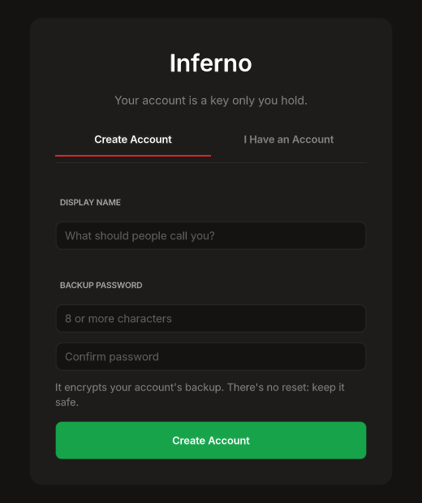
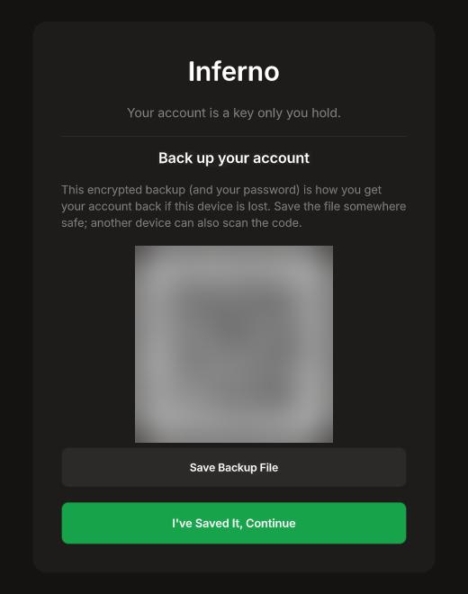
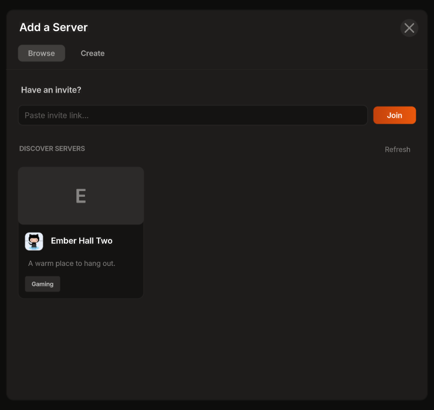
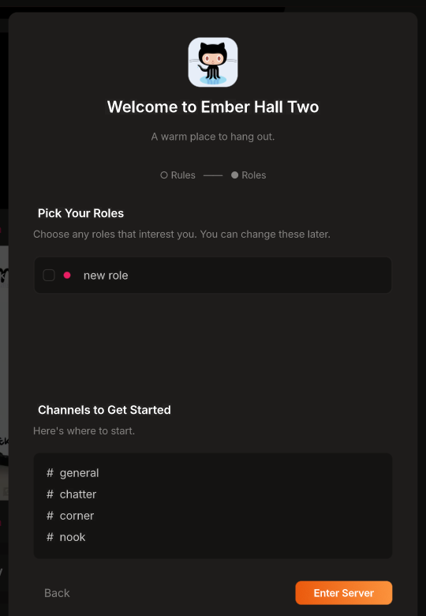
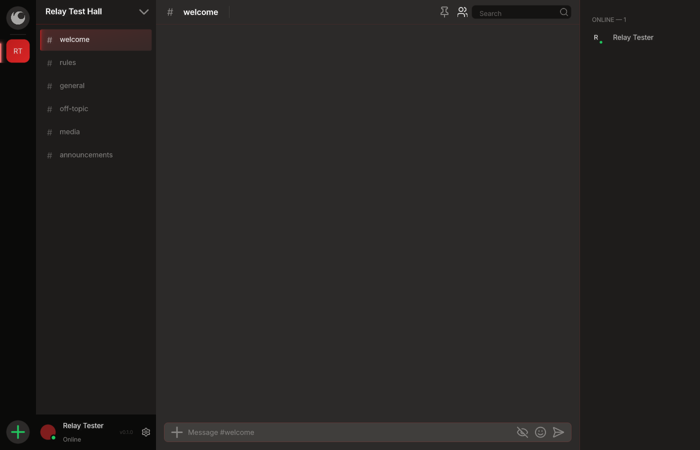

# Inferno

**Blazing fast. Hot to the touch.**

Inferno is a chat app for communities: servers, channels, voice and video,
roles, DMs and bots, in a native desktop app. There's no company server
holding your account: you hold it, as a key on your device, and your
servers live on [Nostr](https://nostr.com) relays.

This repository holds the **downloads** and their release notes. Inferno
itself is closed source.

- [Download](#download)
- [Your first launch](#your-first-launch)
- [Using Inferno](#using-inferno)
- [Voice and video](#voice-and-video)
- [Bots](#bots)
- [Updates](#updates)
- [Checking a download](#checking-a-download)
- [Troubleshooting](#troubleshooting)

## Download

Get the newest version from **[Releases](../../releases/latest)**.

| System | Download | Status |
|---|---|---|
| Linux (x86-64) | `inferno-<version>-linux-x86_64.tar.gz` | Supported |
| Windows, macOS | — | Coming later |

### Linux

```sh
tar -xzf inferno-*-linux-x86_64.tar.gz
cd inferno-*-linux-x86_64
./inferno
```

Keep the folder somewhere you can write to (your home folder is fine): the
app updates itself in place.

To add Inferno to your applications menu:

```sh
mkdir -p ~/.local/share/applications ~/.local/share/icons
sed "s|^Exec=.*|Exec=$PWD/inferno %u|" inferno.desktop > ~/.local/share/applications/inferno.desktop
cp inferno.png ~/.local/share/icons/inferno.png
```

It needs a desktop session (X11 or Wayland), PulseAudio or PipeWire for
sound, and a reasonably recent distribution (Ubuntu 22.04 or newer, or
similar).

## Your first launch

It takes four clicks from opening the app to chatting in a server.

### 1. Create your account

Type a **display name** and a **backup password** (twice), then press
Enter. Your account is a key made on this device; the password encrypts its
backup.

There's no password reset. Nobody else holds your key, so nobody can
recover it for you. Keep the password somewhere safe.



Already have an account? Choose **I Have an Account** to unlock one saved
on this device, link this device from another one, or restore a backup
file.

### 2. Back up your account

Save the encrypted backup (**Save Backup File**), or scan the code with
another device. With the file and your password you can get your account
back if this device is lost. Then click **I've Saved It, Continue**.



### 3. Find a server

Inferno opens **Discover**: public servers you can join with one click. Have
an invite link? Paste it under **Have an invite?** and click **Join**. Or
make your own under **Create**.



### 4. Say hello

Some servers welcome you with their rules and roles to pick. **Agree &
Continue**, pick any roles you like, then **Enter Server**.



You're in.



Your profile picture, banner and About Me are in **Settings → Profile**
(the gear beside your name, bottom left) whenever you want them.

## Using Inferno

- **Servers** are on the rail at the far left. **+** at the bottom adds
  one: Discover, an invite link, or Create.
- **Channels** are in the sidebar. A small lock on a channel's `#` means
  it's encrypted: only members with access can read it.
- **Direct messages:** the Inferno logo at the top of the rail. **Friends →
  Search** finds people by name or public key; **Add** sends a friend
  request.
- **Messages** support Markdown, @mentions, emoji, GIFs, files and
  reactions. Hover a message for reply, react, pin and more.
- **Slash commands:** type `/` in the message bar. Built-ins (`/shrug`,
  `/me`, `/spoiler`, `/gif` …) and your server's bots' commands, with a
  rail to browse by bot.
- **Status:** click your name, bottom left, to set Online, Idle, Do Not
  Disturb or Invisible and a custom status.
- **Content Safety** (Settings): the Fire Shield's filters for links,
  spam, unknown senders and explicit images, all checked on your device.

## Voice and video

Join a voice channel to talk, share your screen or turn on your camera.
Push to talk, noise suppression and per-person volume are in **Settings →
Voice & Video**.

Voice runs on a [LiveKit](https://livekit.io) server that a member of the
server provides: in **Server Settings → Voice**, anyone with LiveKit
credentials (added in Settings → Voice & Video) can **Volunteer as Voice
Provider**. They get the Voice Provider role, and voice works while their
app is open.

## Bots

Server admins add bots by their public key (**Server Settings → Bots**).
Bots bring slash commands, rich replies with cards and buttons, and replies
only you can see. Their messages carry a **BOT** tag.

## Updates

Inferno checks for a new version when it starts and every few hours. When
one is out, a banner offers it: **Update** downloads it, checks it,
installs it and restarts. **What's new** opens its release notes.

## Checking a download

Every download has a `.release.json` beside it: a note signed with
Inferno's release key, giving the version and the file's SHA-256. The
updater refuses any download that doesn't match its signed note.

To check a download by hand:

```sh
sha256sum inferno-*-linux-x86_64.tar.gz
grep -o '"x","[0-9a-f]*"' inferno-*-linux-x86_64.tar.gz.release.json
```

The two hashes must be the same. The note is signed by Inferno's release
key:

```
1766b72fa01679b1b14fe9db79a57bb7b7c1be096133ff9673a7c8db9812e3d6
```

## Troubleshooting

- **"Can't open the X display"** when starting: Inferno needs a desktop
  session. Start it from your desktop, not over SSH or a plain terminal
  login.
- **No sound in voice:** check the microphone and speaker in **Settings →
  Voice & Video**; the mic test there shows what's heard.
- **Voice says no provider:** someone in the server needs to volunteer as a
  voice provider (see [Voice and video](#voice-and-video)).
- **Messages say "Sending…":** no relay has accepted them yet. They're
  kept and sent again automatically; check your connection, or **Settings →
  Relays**.
- **Lost your device?** Restore with your backup file and password: **I
  Have an Account → restore a backup**.

## License

Inferno is proprietary software. All rights reserved. Third-party
components keep their own licenses, listed in `THIRD_PARTY_NOTICES.md` in
each download.
